# Projektrack data model

Status: Phase 0 baseline, 16.11.2026. Owner: solution architecture.

This document defines the complete logical data model of Projektrack across all modules, including modules that ship in later releases (0.10, 1.0, 1.1, 1.2, 1.3, 2.0). The goal is that every later release can add tables and nullable columns (expand), but never has to change or break a table that ships in 0.9. Physical migrations are written per module and per release; this document is the contract they follow.

Related decisions: ADR-0002 (module system), ADR-0003 (editions, licensing, license keys), ADR-0004 (money, tax engine, rounding), ADR-0005 (i18n and RTL), ADR-0006 (multi-tenancy, SaaS, white label), ADR-0007 (workflow and automation engine), ADR-0008 (e-invoicing), ADR-0009 (AI provider layer), and `docs/decisions/assumptions.md`. Where this document and an ADR differ in a detail, the ADR governs the behavior and this document is corrected.

---

## 1. Principles

### 1.1 Tenant ownership

- Every table is either **instance-scoped** (shared reference data and registries, no `tenant_id`) or **tenant-owned** (`tenant_id` NOT NULL). There is no third kind, with one documented exception (1.1.4).
- `tenant_id` is the first column of every composite index on a tenant-owned table. Queries without a tenant predicate are rejected by the central tenant scope (ADR-0006) and by a static analysis rule.
- **Tenant-safe foreign keys**: every tenant-owned table carries a unique index on `(tenant_id, id)`, and foreign keys between tenant-owned tables reference `(tenant_id, <parent>_id)` against that index. A row can therefore never point to a parent of another tenant, even if application code has a bug. This works identically on MySQL 8.4, MariaDB 11.4 and PostgreSQL 16.
- Layered configuration exception (1.1.4): `settings`, `string_overrides`, `feature_flag_overrides`, `brand_profiles` and `document_templates` allow `tenant_id` NULL meaning "instance default". Instance defaults are readable by every tenant and writable only by instance administrators. The resolver always reads tenant row first, then instance row, then the shipped default.
- In the diagrams below, `tenant_id` is shown only in the Core diagrams. **Every entity in every other diagram is tenant-owned and carries `tenant_id` unless the constraint table marks it as instance-scoped.**

### 1.2 Identifiers

Decision: **ULID primary keys** (`char(26)`, Crockford base32, generated in the application) for all entity tables.

| Option | Verdict |
|---|---|
| Auto-increment bigint everywhere | Rejected as public identifier: enumerable (conflicts with "invisible by default"), collides when moving a tenant from the shared database to a dedicated database, cannot be generated offline by the PWA. |
| UUID v4 | Rejected: random order fragments B-tree indexes on MySQL/MariaDB InnoDB. |
| UUID v7 in native `uuid` type | Rejected: no native type on MySQL/MariaDB; would need vendor-specific handling. |
| **ULID as `char(26)`** | **Chosen**: time-ordered (good index locality), portable across all three databases with the same type, safe to expose in URLs and API, generated client-side for offline capture, first-class support in the framework. |

Exceptions:
- **Append-only log tables** that are never referenced by other rows and never exposed by ID (`audit_log`, `automation_run_logs`, `webhook_deliveries`, `shared_link_accesses`, `license_check_ins`, `sla_timer_events`) use `bigint` identity for insertion speed and natural ordering.
- **Instance-scoped catalogs** keyed by a stable string (`modules.key`, `permissions.key`, `currencies.code`, `country_packs.code`, `ai_use_cases.key`, `ai_data_categories.key`) use that string as primary key.
- **Pure pivot tables** use a composite primary key.
- **Human-facing numbers** (invoice `INV-2026-0001`, issue key `PTK-123`, quote `Q-2026-014`) are separate, unique-per-tenant columns and never replace the ULID.

### 1.3 Data types (portable subset)

Only types that behave the same on MySQL 8.4, MariaDB 11.4 and PostgreSQL 16 are used. Vendor-specific SQL lives only in the tested adapter layer (full-text search, JSON path queries, advisory locks).

| Logical type in this document | Physical type | Notes |
|---|---|---|
| `ulid` | `char(26)` | ASCII collation on MySQL/MariaDB for compact indexes. |
| `string` | `varchar(n)`, n at most 191 when indexed | Keeps index size within limits on every engine and row format. |
| `text` | `text` | Never indexed directly; searched through the search adapter. |
| `int` / `bigint` | `integer` / `bigint` | Signed. |
| `bool` | `boolean` | `tinyint(1)` on MySQL/MariaDB through the schema builder. |
| `decimal` | `decimal(p,s)` | Only for quantities, exchange rates and scores, never for money. |
| `date` | `date` | Calendar dates in the local calendar of the business fact (booking date, invoice date). |
| `datetime` | `datetime` / `timestamp without time zone` | Always UTC. The MySQL `timestamp` type is not used (year 2038 limit, implicit conversion). |
| `json` | `json` | Stored and read as a document. Never filtered with vendor JSON operators outside the adapter layer. Anything that must be filtered or sorted is a real column. |
| `char2` / `char3` | `char(2)` / `char(3)` | ISO 3166-1 alpha-2 country, ISO 4217 currency. |
| `hash` | `char(64)` | Lowercase hex SHA-256. |
| `enc` | `text` | Application-level encrypted value (envelope encryption, key outside the database). |

Native `ENUM` types, database triggers, stored procedures, partial indexes, generated columns and check constraints with vendor syntax are not used. Enumerations are `varchar(32)` validated by the domain layer. Where a conditional unique constraint is needed, the "nullable claim key" pattern is used: a nullable column that holds a value only while the row is active, combined with a normal unique index (all three engines allow multiple NULLs in a unique index).

### 1.4 Money

- Amounts are **integers in minor units** (`bigint`, suffix `_minor`) plus a `char(3)` ISO 4217 currency column on the same row or on the parent document. Never float, never decimal.
- The number of minor digits per currency comes from the instance-scoped `currencies` table (EUR 2, BAM 2, USD 2, JPY 0, KWD 3).
- **Unit prices and hourly rates** may carry more precision than the currency and are stored as `decimal(19,4)` (columns `rate`, `unit_price`, `unit_cost`), handled as arbitrary-precision decimals in code (ADR-0004). Every computed amount (line net, valuation, tax) is rounded once at the rounding points defined in ADR-0004 (default `HALF_UP`, VAT per rate group) and stored as integer minor units.
- Percentages and tax rates are integers in **parts per million** (`_ppm`): 19 % = 190000, 17 % = 170000, 8.875 % = 88750. This covers US sales tax rates with three decimals, which basis points cannot represent, as used in ADR-0004.
- Exchange rates are `decimal(20,10)` (`from_currency`, `to_currency`, `rate_date`, `source`) and are always copied onto the document or valuation that used them, together with the converted amount. Converted amounts are never recomputed later.
- Every financial document stores both document currency amounts and tenant base currency amounts.

### 1.5 Durations and time

- Durations are **integer minutes** (`_minutes`). Where a raw and a rounded value both matter (time entries), both are stored (`duration_minutes`, `billable_minutes`).
- Instants are `datetime` in **UTC** (`_at` suffix). Display uses the user or tenant time zone; documents use the time zone of the tenant that issues them.
- Business dates are `date` (`_date` or `_on` suffix) in the local calendar where the fact happened (a booking on 31.10. stays on 31.10. regardless of the viewer's zone).
- Business-hour calculations (SLA, auto-scheduling) are done in the time zone of the business calendar, so daylight saving changes are handled by the calendar, not by stored offsets.
- Storage is always Gregorian; Jalali and Hijri are display-only.

### 1.6 Soft delete versus immutability

| Category | Rule | Examples |
|---|---|---|
| Master data | Soft delete (`deleted_at`), restorable, excluded by default scope. Hard purge only by retention job or GDPR erasure. | companies, contacts, projects, work packages, issues, pages, boards |
| Personal data | GDPR/CCPA erasure replaces personal fields with pseudonyms and sets `anonymized_at`; the row and its references remain so financial and audit records stay consistent. | users, contacts, inbound_messages, ai_request_payloads |
| Financial and legal records | **Immutable after finalization.** No update of business columns, no delete, no soft delete. Corrections only through new rows (cancellation invoice, credit note, correction time entry, new report version). Status columns move forward only. | invoices, invoice_lines, number_allocations, payments, einvoice_documents, service_report_versions, quote_versions after sending, licenses |
| Evidence | Append-only, never updated except technical delivery status. | audit_log, signoffs, acceptances, ai_requests, license_check_ins, webhook_deliveries |
| Drafts | Hard delete allowed while in draft and owned by the actor; the deletion itself is audited. | draft time entries, draft invoices without number, draft quotes |

Immutability is enforced in the domain layer (no update path), verified by tests, and made tamper-evident by content hashes and the audit hash chain. Database triggers are not used (portability).

Editable aggregates carry `lock_version int` for optimistic locking (concurrent editing, offline sync).

### 1.7 Translatable master data

- UI strings live in language packs, not in the database. Only **tenant-defined master data** is stored translated.
- Pattern: base table holds language-neutral columns plus a `key`; a sibling table `<entity>_translations` holds `(tenant_id, <entity>_id, locale, name, description, ...)` with a unique index on `(<entity>_id, locale)`.
- Resolution order follows the string fallback chain: requested locale, tenant locale, `bs`, `en`. A missing translation never shows a raw key.
- System-shipped master data (default issue types, default statuses, tax notices) references string identifiers (`name_string`, for example `work:issue_type_bug`) instead of translation rows, so language packs and admin string overrides apply. A tenant can replace the string reference with its own translations at any time.
- Documents store the **document locale** used to render them, independent of the creator's UI language.

### 1.8 Audit hash chain

- `audit_log` is append-only per tenant with a gapless per-tenant `seq`.
- `hash = HMAC-SHA256(chain_key[key_id], prev_hash || canonical_json(entry without id and hash))` (security baseline 8.2). The chain key is derived from the application key, so database write access alone cannot produce valid hashes; `key_id` lets entries written before a key rotation verify. Canonical JSON: sorted keys, UTF-8, no insignificant whitespace, no floats, timestamps in UTC with microseconds. `context` is stored as canonical JSON text so every engine returns it unchanged.
- Writers serialize through `audit_chain_heads` (one row per tenant, `SELECT ... FOR UPDATE` inside the business transaction), which works on all three engines. The audit entry commits atomically with the change it describes.
- `audit_checkpoints` periodically store `(seq, hash)` signed with the instance key and optionally exported off-system, so truncation of the tail is also detectable.
- A verification command recomputes the chain and reports the first broken link.
- Covered: logins and authentication events, permission and role changes, financial records, exports, settings, module and feature changes, AI calls, shared link access, license changes.
- Personal data in audit entries is minimized (identifiers, not content). IP addresses are stored for security events and pruned according to the retention policy.

### 1.9 Versioned snapshots

Documents that leave the system or carry legal weight are frozen as versions:

- A version row stores `version_no`, a canonical JSON **snapshot** of everything needed to re-render it (including buyer and seller data, rates, texts, locale), `content_hash`, and the rendered files (with their own SHA-256).
- A frozen version is never updated. Changes create version `n+1` that points to the version it supersedes.
- Applies to: service report versions, quote versions, invoices (single version, immutable), e-invoice documents, workflow versions, automation rule versions, page versions, baselines, prompt template versions, licenses.

### 1.10 Common columns and conventions

- Every entity table: `id`, `tenant_id` (if tenant-owned), `created_at`, `updated_at`, `created_by` and `updated_by` (user ULID or NULL for system actors).
- Polymorphic references use `<name>_type` (a stable morph alias such as `time_entry`, never a class name) plus `<name>_id`.
- **Cross-module references**: a foreign key constraint is declared only towards a module listed in the referencing module's `requires`. References to optional or later modules are **soft references**: an indexed ULID column without a database constraint, kept consistent through domain events and the module contract (ADR-0002). Example: `time_entries.issue_id` exists from 0.9 although issues ship in 1.0.
- Table names are plural snake_case, owned by exactly one module, and prefixed by domain where ambiguity is possible.
- Expand/contract migrations only: new columns are nullable or have defaults; renames and drops happen at the earliest one minor release after the code stopped using them.

### 1.11 Search, files and large content

- Searchable text is indexed through the search adapter (database full-text on AMP, Meilisearch when configured). Search documents carry `tenant_id` and permission filters.
- Binary content never lives in the database. `files` stores metadata, the storage key and SHA-256; content lives on the local disk or S3-compatible storage under a per-tenant prefix.

---

## 2. Core A: tenancy, identity and access

```mermaid
erDiagram
    tenants {
        ulid id PK
        string slug UK
        string name
        string status
        char2 country_code
        string default_locale
        char3 base_currency
        string timezone
        string region
        string isolation_mode
        string edition
        datetime created_at
    }
    tenant_domains {
        ulid id PK
        ulid tenant_id FK
        string host UK
        string kind
        bool is_primary
        string tls_status
        datetime verified_at
    }
    brand_profiles {
        ulid id PK
        ulid tenant_id FK
        string product_name
        ulid logo_file_id
        ulid favicon_file_id
        json tokens
        string email_sender_name
        string email_sender_domain
        bool show_powered_by
    }
    users {
        ulid id PK
        ulid tenant_id FK
        string email_normalized
        string display_name
        string user_type
        string status
        string locale
        string format_locale
        string timezone
        string password_hash
        int session_version
        bool is_contractor
        bool is_exempt
        datetime last_login_at
        datetime anonymized_at
        datetime deleted_at
    }
    user_invitations {
        ulid id PK
        ulid tenant_id FK
        string email_normalized
        ulid role_id FK
        json project_assignments
        hash token_hash UK
        datetime expires_at
        datetime accepted_at
    }
    auth_factors {
        ulid id PK
        ulid tenant_id FK
        ulid user_id FK
        string kind
        enc secret
        datetime confirmed_at
        datetime last_used_at
    }
    webauthn_credentials {
        ulid id PK
        ulid tenant_id FK
        ulid user_id FK
        string credential_id UK
        text public_key
        bigint sign_count
        string label
        datetime last_used_at
    }
    sso_providers {
        ulid id PK
        ulid tenant_id FK
        string protocol
        string name
        enc config
        bool enforce
        bool jit_provisioning
    }
    user_identities {
        ulid id PK
        ulid tenant_id FK
        ulid user_id FK
        ulid sso_provider_id FK
        string subject
    }
    user_sessions {
        string id PK
        ulid tenant_id FK
        ulid user_id FK
        string device_label
        string ip_hash
        datetime last_activity_at
        datetime reauthenticated_at
    }
    roles {
        ulid id PK
        ulid tenant_id FK
        string key
        string name_string
        string template_key
        bool is_system
        string licensed_user_type
    }
    role_translations {
        ulid id PK
        ulid role_id FK
        string locale
        string name
        text description
    }
    permissions {
        string key PK
        string module_key
        string risk_level
        string description_string
    }
    role_permissions {
        ulid role_id PK
        string permission_key PK
    }
    user_roles {
        ulid user_id PK
        ulid role_id PK
        ulid tenant_id FK
    }
    field_permissions {
        ulid id PK
        ulid tenant_id FK
        ulid role_id FK
        string entity_type
        string field
        string access
    }
    project_roles {
        ulid id PK
        ulid tenant_id FK
        string key
        string name_string
        bool is_system
    }
    project_role_translations {
        ulid id PK
        ulid project_role_id FK
        string locale
        string name
    }
    project_role_permissions {
        ulid project_role_id PK
        string permission_key PK
    }
    user_groups {
        ulid id PK
        ulid tenant_id FK
        string name
        ulid lead_user_id FK
        string external_ref
    }
    user_group_members {
        ulid user_group_id PK
        ulid user_id PK
    }

    tenants ||--o{ tenant_domains : "served at"
    tenants ||--o| brand_profiles : "branded by"
    tenants ||--o{ users : owns
    tenants ||--o{ roles : defines
    tenants ||--o{ project_roles : defines
    tenants ||--o{ sso_providers : configures
    tenants ||--o{ user_invitations : issues
    users ||--o{ auth_factors : has
    users ||--o{ webauthn_credentials : has
    users ||--o{ user_identities : "linked to"
    sso_providers ||--o{ user_identities : authenticates
    users ||--o{ user_sessions : opens
    users ||--o{ user_roles : holds
    roles ||--o{ user_roles : "granted via"
    roles ||--o{ role_permissions : bundles
    permissions ||--o{ role_permissions : "part of"
    roles ||--o{ role_translations : "named in"
    roles ||--o{ field_permissions : restricts
    project_roles ||--o{ project_role_translations : "named in"
    project_roles ||--o{ project_role_permissions : bundles
    permissions ||--o{ project_role_permissions : "part of"
    user_groups ||--o{ user_group_members : contains
    users ||--o{ user_group_members : "member of"
```

| Table | Key constraints and indexes | First release |
|---|---|---|
| tenants | Instance-scoped. `slug` unique; `region` and `isolation_mode` (shared, dedicated_db) drive routing (ADR-0006). | 0.9 |
| tenant_domains | Instance-scoped lookup table (host to tenant) with `tenant_id`. `host` unique across the instance; `kind` = random, alias, custom. | 0.9 |
| brand_profiles | Layered: `tenant_id` NULL = instance brand. Unique `(tenant_id)`. | 0.9 |
| users | Unique `(tenant_id, email_normalized)`; index `(tenant_id, status, user_type)` for license counting. `user_type` = full, light, portal, service. Soft delete plus anonymization. `session_version` (S-0903) moves on when other sessions are signed out or the password is changed or reset; sessions of an older version end. | 0.9 |
| auth_factors | `kind` = totp, recovery_codes. Secrets encrypted. | 0.9 |
| webauthn_credentials | `credential_id` unique per instance. | 0.9 |
| sso_providers, user_identities | Unique `(sso_provider_id, subject)`. OIDC in 0.9 data model, UI in 1.0; SAML and SCIM Enterprise. | 1.0 |
| roles, role_translations | Unique `(tenant_id, key)`; unique `(role_id, locale)`. Role templates seeded per tenant. | 0.9 |
| permissions | Instance-scoped, synced from `module.json` on module install. | 0.9 |
| field_permissions | Unique `(role_id, entity_type, field)`. Default for financial fields: hidden. | 0.9 |
| project_roles | Used by `project_members` (Projects). | 0.9 |
| user_groups | Teams and departments; used by absences, queues, approvals. `external_ref` for SCIM groups. | 0.9 |

---

## 3. Core B: platform services

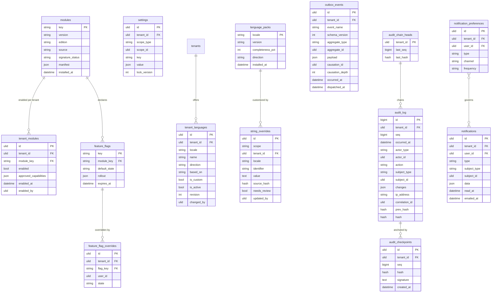

| Table | Key constraints and indexes | First release |
|---|---|---|
| modules | Instance-scoped registry. `signature_status` = verified, unsigned, invalid. | 0.9 |
| tenant_modules | Unique `(tenant_id, module_key)`. Disabling keeps data. | 0.9 |
| feature_flags, feature_flag_overrides | Flags instance-scoped; overrides layered (tenant or user). | 0.9 |
| settings | Layered. Unique `(tenant_id, scope_type, scope_id, key)`; `scope_type` = tenant, user, project, module. Values validated against the module settings schema. | 0.9 |
| language_packs | Instance-scoped. | 0.9 |
| tenant_languages | Tenant-owned. A row only where the tenant differs from the shipped languages: a deactivated language (`is_active` false) or its own language copied from `based_on` (`is_custom`). Unique `(tenant_id, locale)`; `revision` increments with every change to the language's strings and is part of the browser bundle version (S-0921). | 0.9 |
| string_overrides | Layered (`scope` = instance or tenant, ADR-0005). Unique `(scope, tenant_id, locale, identifier)`; `source_hash` flags overrides whose English source changed after an update. Legal notice strings need a dedicated permission to override. | 0.9 |
| audit_log | Unique `(tenant_id, seq)`; index `(tenant_id, subject_type, subject_id)`, `(tenant_id, actor_id, occurred_at)`. Append-only. | 0.9 |
| audit_chain_heads, audit_checkpoints | One head per tenant; checkpoint daily and on demand. | 0.9 |
| outbox_events | Index `(dispatched_at, occurred_at)`; written in the same transaction as the change; dispatcher marks delivered. Retention 30 days after dispatch. | 0.9 |
| notifications | Index `(tenant_id, user_id, read_at)`. Digest mode via `frequency`. | 0.9 |

---

## 4. Core C: files, documents, sharing and integration

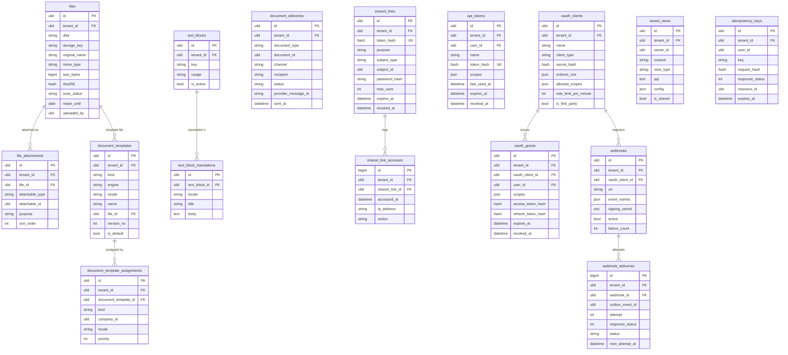

| Table | Key constraints and indexes | First release |
|---|---|---|
| files | Index `(tenant_id, sha256)` for deduplication; `scan_status` = pending, clean, infected, skipped. Storage key under `tenants/{tenant_id}/`. Downloads only through signed URLs. | 0.9 |
| file_attachments | Index `(tenant_id, attachable_type, attachable_id)`. | 0.9 |
| document_templates | Layered (instance defaults). `kind` = service_report, quote, invoice, credit_note, dunning, email, costing_sheet. `engine` = docx, html. | 0.9 |
| document_template_assignments | Resolution: company plus locale, then locale, then default, by `priority`. | 0.9 |
| text_blocks | Used by quotes, invoices, emails. | 0.10 |
| document_deliveries | Index `(tenant_id, document_type, document_id)`. | 0.9 |
| shared_links | Token at least 128 bits, only the hash is stored. Default expiry 30 days. `purpose` = report_signoff, quote_acceptance, roadmap, portal_invite, download, csat. | 0.9 |
| api_tokens | Personal access tokens with scopes. | 0.9 |
| oauth_clients, oauth_grants | Apps, ecosystem plugins, MCP clients. | 1.0 |
| webhooks, webhook_deliveries | HMAC-signed; SSRF-checked target; exponential retry; disabled after repeated failure. | 1.0 |
| saved_views | `view_type` = list, board, table, timeline, calendar, gantt, roadmap, workload. | 1.0 |
| idempotency_keys | Unique `(tenant_id, user_id, key)`. Used by the API and by PWA offline sync. | 0.9 |

---

## 5. CRM

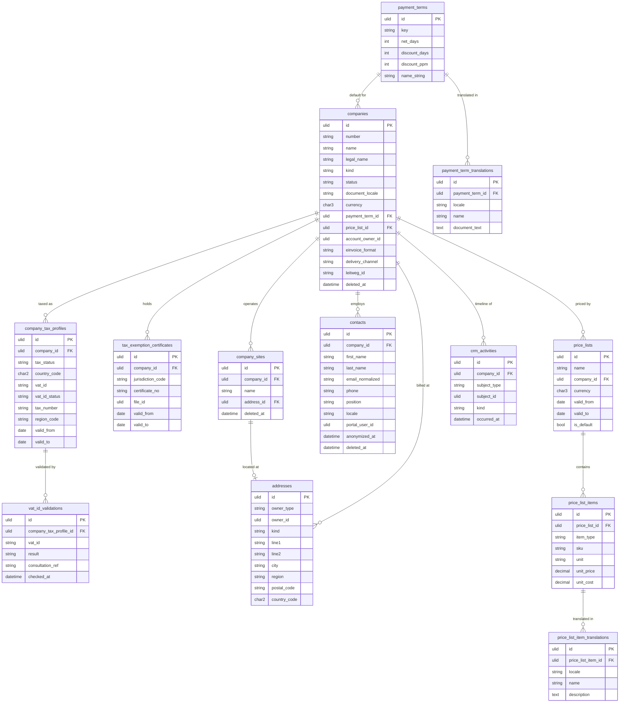

| Table | Key constraints and indexes | First release |
|---|---|---|
| companies | Unique `(tenant_id, number)`; index `(tenant_id, name)`. `kind` = customer, supplier, partner, prospect. `leitweg_id` is the routing ID for public-sector e-invoices (ADR-0008), overridable on the contract and copied to the invoice as buyer reference (BT-10). `einvoice_format` = pdf, zugferd, xrechnung_ubl, xrechnung_cii. | 0.9 |
| company_tax_profiles | Validity ranges, no overlap per company (domain check). `tax_status` = domestic, eu_business, non_eu_business, private, exempt, public_sector (ADR-0004). Invoices snapshot the profile, so later changes never alter issued documents. | 0.9 |
| vat_id_validations | Evidence for reverse charge (VIES result and consultation reference). | 0.9 (optional VIES) |
| tax_exemption_certificates | US sales tax exemption. | 1.0 |
| addresses | Index `(tenant_id, owner_type, owner_id, kind)`. Address format per country rendered by locale data. | 0.9 |
| contacts | Unique `(tenant_id, company_id, email_normalized)` when email present. `portal_user_id` soft link to `users` with `user_type` portal. | 0.9 |
| payment_terms | System terms (Net 15/30/45/60, due on receipt) use `name_string`. | 0.9 |
| price_lists, price_list_items | Hourly rates are not here: they live in `rate_rules` with `price_list_id`. Items cover fixed items, materials and licenses. | 0.9 (hourly), 0.10 (items for quotes) |
| crm_activities | Projection rebuilt from domain events; never authoritative. | 0.9 |

---

## 6. Projects

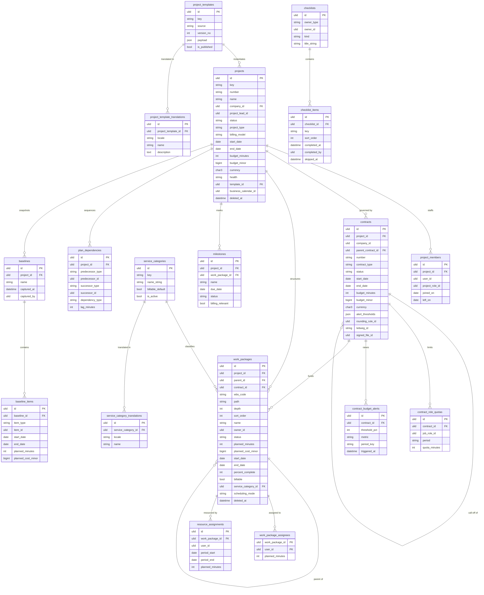

| Table | Key constraints and indexes | First release |
|---|---|---|
| projects | Unique `(tenant_id, key)`, unique `(tenant_id, number)`; index `(tenant_id, company_id, status)`. `billing_model` = time_and_material, fixed_price, retainer, hour_package, mixed, internal. | 0.9 |
| project_members | Unique `(project_id, user_id, project_role_id)`. | 0.9 |
| contracts | Unique `(tenant_id, number)`. `contract_type` = framework, call_off, time_and_material, fixed_price, hour_package, retainer, maintenance. Default thresholds 70/90/100. | 0.9 |
| contract_role_quotas | Unique `(contract_id, job_role_id, period)`; `period` = month, quarter, term. | 0.9 |
| contract_budget_alerts | Unique `(contract_id, metric, threshold_pct, period_key)`: each alert fires once. | 0.9 |
| work_packages | Materialized path (`path` = zero-padded sort keys) plus `parent_id`; index `(tenant_id, project_id, path)`. `wbs_code` (1, 1.1, 1.1.2) recomputed on move. Portable tree without recursive CTE dependency. `scheduling_mode` = manual, auto. | 0.9 |
| milestones | | 0.9 (list), 1.0 (Gantt) |
| plan_dependencies | Unique `(predecessor_type, predecessor_id, successor_type, successor_id)`; cycle check in the domain. FS, SS, FF, SF with lead/lag. Items: work package, milestone, issue (soft ref). | 1.0 |
| baselines, baseline_items | Immutable once captured. | 1.2 |
| resource_assignments | Capacity planning per period. | 1.2 |
| project_templates | Layered: `source` = system, tenant, partner, import. `payload` holds WBS, roles, workflow keys, automation rule keys, wiki pages, board and views; importable/exportable as JSON. | 0.9 (basic), 1.0 (gallery) |
| checklists | `owner_type` = tenant (getting started), project (kickoff), user (welcome). | 0.9 |

---

## 7. Time

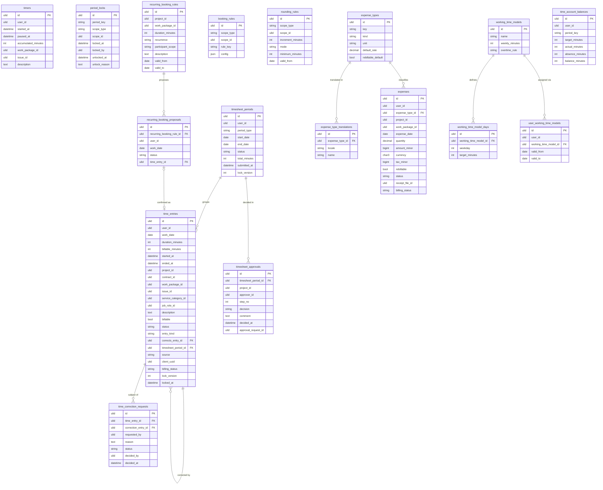

| Table | Key constraints and indexes | First release |
|---|---|---|
| time_entries | Index `(tenant_id, user_id, work_date)`, `(tenant_id, work_package_id, work_date)`, `(tenant_id, contract_id, work_date)`, `(tenant_id, project_id, status)`. Unique `(tenant_id, client_uuid)` for offline idempotency. `status` = draft, submitted, approved, rejected. `entry_kind` = regular, correction, reversal. `source` = manual, timer, recurring, import, api, ai_suggestion. `billing_status` = unbilled, reported, invoiced, written_off. `issue_id` is a soft reference (Work module, 1.0). After approval only `billing_status` changes. | 0.9 |
| timers | Unique `(tenant_id, user_id)`: one running timer per user. | 0.9 |
| timesheet_periods | Unique `(tenant_id, user_id, period_type, start_date)`. | 0.9 |
| timesheet_approvals | One row per approver decision (per project lead, optional customer sign-off). `approval_request_id` soft link to the engine from 1.0 (ADR-0007). | 0.9 |
| period_locks | Unique `(tenant_id, period_key, scope_type, scope_id)`; `period_key` = `YYYY-MM`. Unlock is audited and never edits approved entries. | 0.9 |
| time_correction_requests | A correction creates a reversal and a new correction entry; original stays unchanged. | 0.9 |
| recurring_booking_rules, recurring_booking_proposals | Unique `(rule_id, user_id, work_date)`: proposals are never duplicated; confirmation creates the entry. `recurrence` is an RFC 5545 RRULE string. | 0.10 |
| booking_rules | Mandatory fields, max hours warnings, minimum booking. | 0.9 |
| rounding_rules | `scope_type` = tenant, company, contract; most specific wins; `mode` = up, nearest, down. | 0.9 |
| expenses, expense_types | Mileage stored as `quantity` in the unit of the type (km or mi). | 0.10 |
| working_time_models, user_working_time_models | Validity ranges, no overlap per user. | 0.9 (model), 1.x (HR light balances) |
| time_account_balances | Projection per month; rebuilt from entries and absences. | 1.1 |

---

## 8. Rates

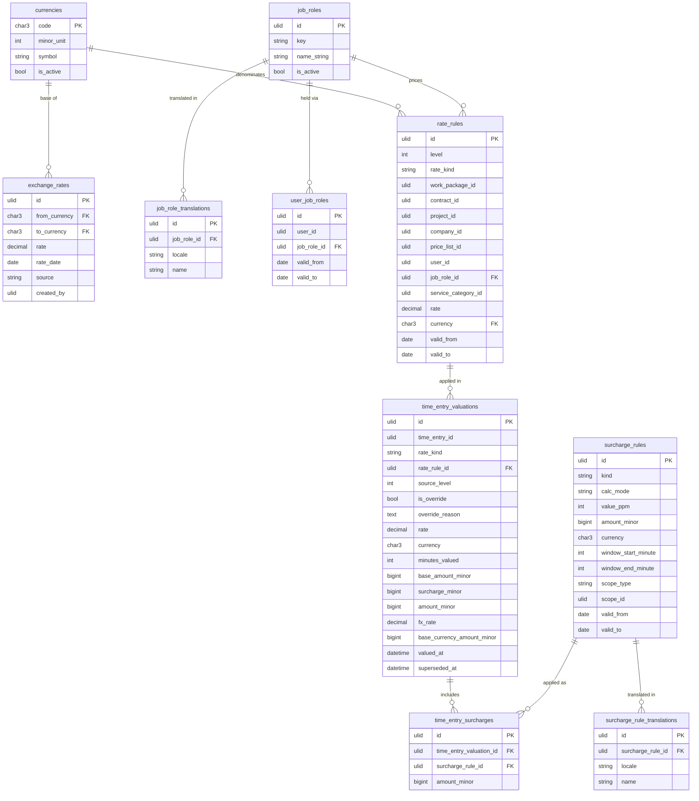

| Table | Key constraints and indexes | First release |
|---|---|---|
| currencies | Instance-scoped, seeded from ISO 4217. | 0.9 |
| exchange_rates | Unique `(tenant_id, from_currency, to_currency, rate_date, source)`. `source` = fixed, manual, `import:<provider>`. BAM/EUR fixed rate 1.95583 seeded with `source` = fixed and not editable (A-10, ADR-0004). | 0.9 |
| job_roles, user_job_roles | The "Role" level of the rate hierarchy (Junior Consultant, Senior IT Project Lead, Technical Architect). Distinct from permission roles. | 0.9 |
| rate_rules | The price list entries of ADR-0004 section 12. `level` 2 to 8 = work package, contract, project, customer, employee, role, tenant default (level 1 = manual rate on the valuation, permission `timesheets.set_rate`). Within a level an entry may be generic or qualified by `user_id` or `job_role_id`. Index `(tenant_id, rate_kind, level, valid_from)` plus one index per scope column. Domain check: no overlapping validity for the same scope and qualifier. Entries used in a snapshot can only be ended, never edited. `rate_kind` = sales, cost. | 0.9 |
| surcharge_rules | `kind` = weekend, holiday, night, on_call. Percentage (`value_ppm`) or fixed amount. | 0.10 |
| time_entry_valuations | The rate snapshot of ADR-0004 (rate, source level, rule, currency, exchange rate) kept as a separate row per entry and rate kind, so sales and cost snapshots and their history do not widen `time_entries`. One active row per `(time_entry_id, rate_kind)`, enforced with the nullable claim key pattern (`active_key`). Unapproved entries are revalued (the row is superseded); the row is frozen on approval and approved, reported or invoiced entries are never revalued, which makes rate changes non-retroactive by construction. `source_level` is shown in the UI as the source of the applied rate. Cost valuations are hidden by field permission. | 0.9 |

---

## 9. Service reports

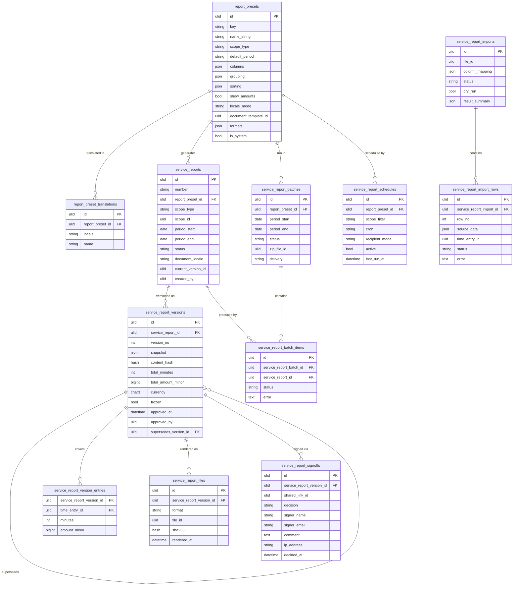

Templates for service reports are `document_templates` with `kind` = service_report (Core C); presets reference them and `document_template_assignments` resolve per customer and language.

| Table | Key constraints and indexes | First release |
|---|---|---|
| report_presets | System presets: work package, employee, project with all employees, contract, customer. Default period previous month, default sort by date. | 0.9 |
| service_reports | Unique `(tenant_id, number)`; index `(tenant_id, scope_type, scope_id, period_start)`. `status` = draft, approved, signed_off, invoiced, superseded. | 0.9 |
| service_report_versions | Unique `(service_report_id, version_no)`. Frozen versions are immutable; `snapshot` holds all rows, totals (per role, service category, work package, employee, grand total) and budget consumption as rendered. | 0.9 |
| service_report_version_entries | Traceability from report to time entries; drives `time_entries.billing_status` = reported. | 0.9 |
| service_report_files | One file per format per version (docx, pdf, xlsx, csv). XLSX totals are formulas. | 0.9 |
| service_report_signoffs | Evidence: timestamp, name, IP. Append-only. | 1.0 (Business sign-off workflow), table from 0.9 |
| service_report_batches | ZIP or email for all reports of a period. | 0.9 |
| service_report_schedules | Month-end generation, sent to project lead for review. | 0.10 |
| service_report_imports | Column mapping wizard, dry run, idempotent re-run per row. | 0.10 |

---

## 10. Quotes

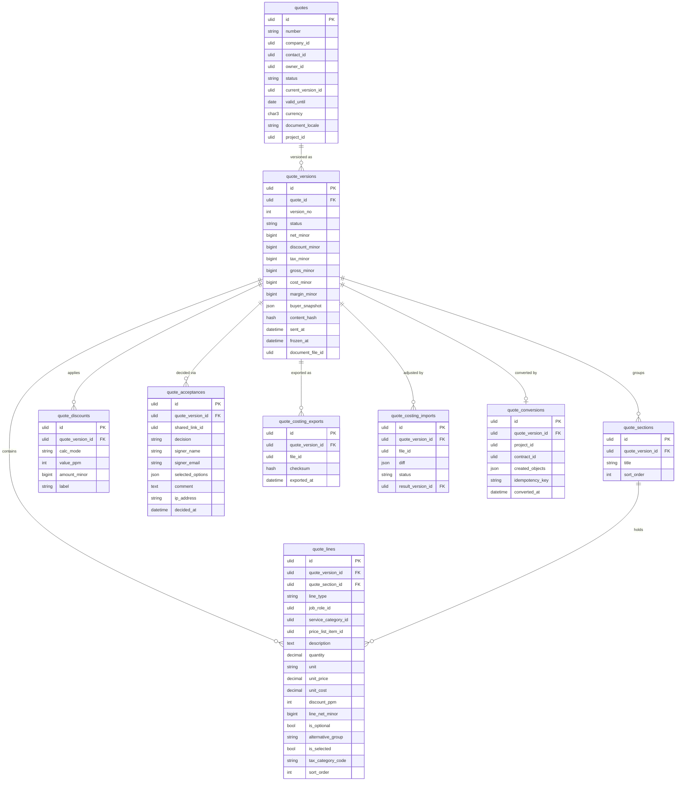

| Table | Key constraints and indexes | First release |
|---|---|---|
| quotes | Unique `(tenant_id, number)`. `status` = draft, sent, accepted, declined, expired. | 0.10 (0.9 should-have) |
| quote_versions | Unique `(quote_id, version_no)`; frozen when sent. Displayed as Q-2026-014 v2. | 0.10 |
| quote_lines | `line_type` = hours_by_role, fixed, material, license, text. Optional and alternative items via `is_optional`, `alternative_group`. Cost columns hidden by field permission. | 0.10 |
| quote_acceptances | Online acceptance evidence; append-only. | 0.10 |
| quote_costing_exports, quote_costing_imports | XLSX with formulas; re-import produces a new version, never edits a sent one. | 0.10 |
| quote_conversions | Unique `(quote_version_id)` and `(tenant_id, idempotency_key)`: one-click conversion runs once. | 0.10 |

---

## 11. Invoicing A: documents, numbering, payments, dunning

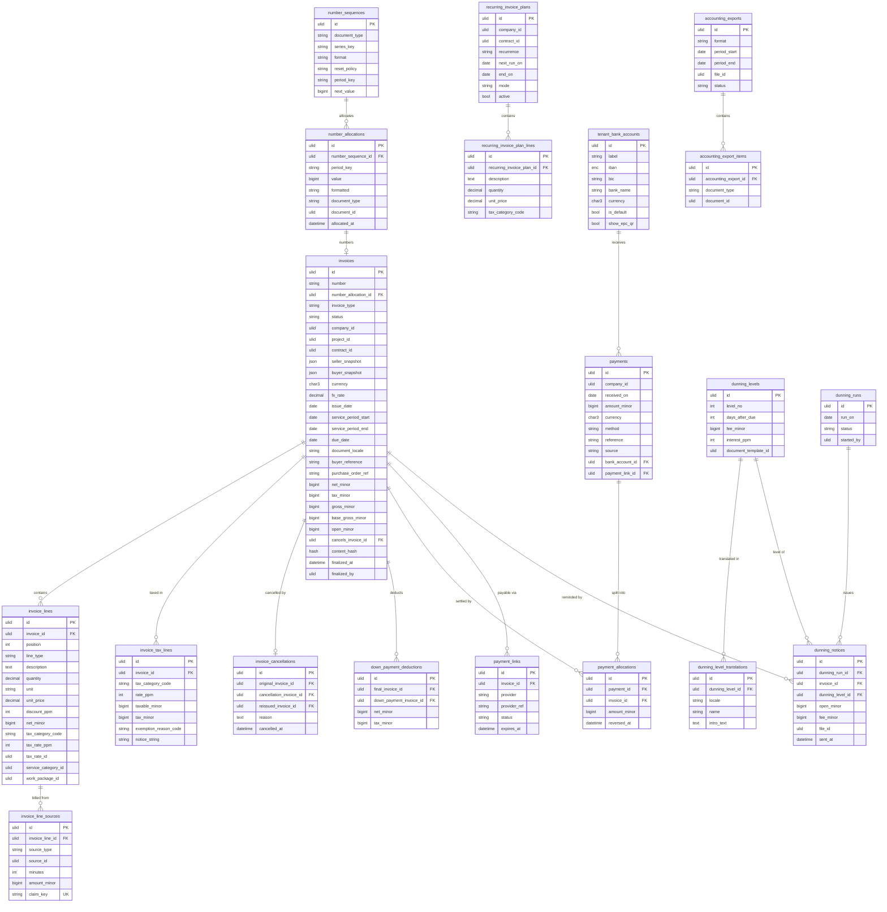

| Table | Key constraints and indexes | First release |
|---|---|---|
| invoices | Unique `(tenant_id, number)` when set; index `(tenant_id, company_id, status)`, `(tenant_id, due_date, status)`. `invoice_type` = standard, time_and_material, fixed_price, down_payment, final, recurring, credit_note, cancellation. Number, snapshots, amounts and `content_hash` set in the finalize transaction; afterwards only `status` and `open_minor` change. | 0.9 |
| invoice_lines, invoice_tax_lines | Immutable after finalize. Tax lines grouped per category and rate (multiple rates per invoice). | 0.9 |
| invoice_line_sources | `source_type` = time_entry, expense, service_report_version, quote_line, milestone, subscription_item. `claim_key` = `source_type:source_id` while the invoice is not cancelled, NULL after cancellation: a unique index prevents double billing on every engine. | 0.9 |
| invoice_cancellations | A cancellation invoice mirrors the original with negated amounts; the original is never changed except `status`. US tenants see "credit memo" labels on the same structure. | 0.9 |
| number_sequences | Unique `(tenant_id, document_type, series_key, period_key)` (ADR-0004 section 10). Row locked with `SELECT ... FOR UPDATE` during finalize; the increment rolls back with the transaction, so numbers are gapless. Default format `INV-{YYYY}-{####}`, yearly reset (A-09); period key from the tenant time zone date of finalization. | 0.9 |
| number_allocations | Unique `(number_sequence_id, period_key, value)` and unique `(tenant_id, document_type, formatted)`. Gap report available. | 0.9 |
| recurring_invoice_plans | Retainer, maintenance, SaaS; `mode` = draft_for_review, auto_finalize. | 0.10 |
| tenant_bank_accounts | IBAN encrypted at rest, printed on invoices; EPC QR optional. | 0.9 |
| payments, payment_allocations | Partial payments; reversal by `reversed_at`, never delete. Payment received drives license activation on the PROJEKTRA tenant. | 0.9 (manual), 0.10 (open items) |
| payment_links | Provider adapters (tenant is the merchant). | 1.1 |
| dunning_levels, dunning_runs, dunning_notices | Unique `(invoice_id, dunning_level_id)` per notice. | 0.10 |
| accounting_exports | DATEV booking batch CSV, CSV, IIF. | 0.10 (CSV), 1.3 (DATEV) |

---

## 12. Invoicing B: tax engine and e-invoicing

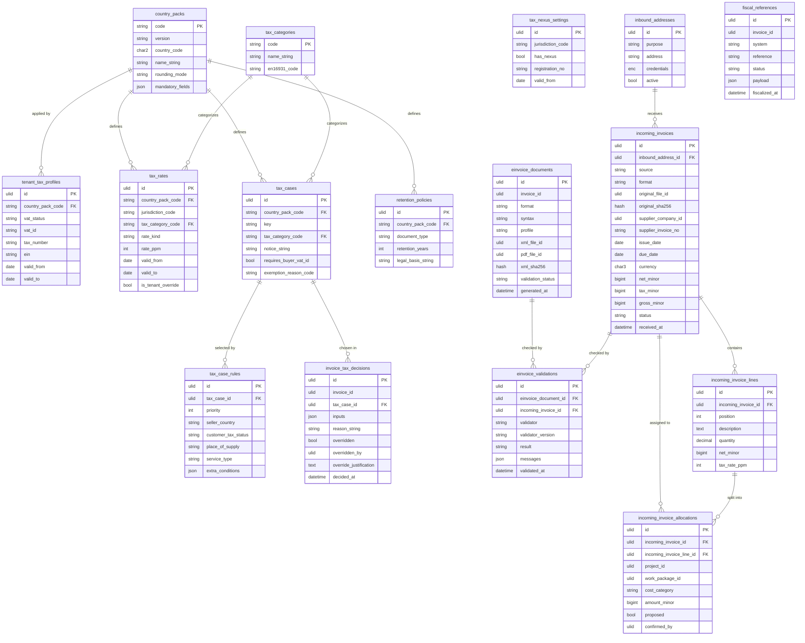

| Table | Key constraints and indexes | First release |
|---|---|---|
| country_packs | Instance-scoped, shipped as modules (`taxpack_de`, `taxpack_ba`, `taxpack_eu` in 0.9; `taxpack_us` in 1.0). Versioned; tenants pin to the installed version. | 0.9 |
| tenant_tax_profiles | Validity ranges; `vat_status` = registered, small_business, exempt, not_registered. | 0.9 |
| tax_categories | Instance-scoped: S, Z, E, AE (reverse charge), K, G, O (outside scope), L, M, plus US sales tax codes. | 0.9 |
| tax_rates | Shipped rates are instance-scoped (`tenant_id` NULL, layered); tenant overrides with `is_tenant_override`. Unique `(country_pack_code, jurisdiction_code, tax_category_code, rate_kind, valid_from)`. | 0.9 |
| tax_cases, tax_case_rules | Data for the decision table of ADR-0004 (first matching row wins, no match = `MANUAL_REVIEW_REQUIRED`). Keys as in ADR-0004, for example `DE_DOMESTIC_STANDARD`, `EU_B2B_REVERSE_CHARGE`, `NON_EU_B2B_OUTSIDE_SCOPE`, `DE_SMALL_BUSINESS`, `BA_DOMESTIC_STANDARD`, `BA_EXPORT_SERVICE_B2B`, `US_SALES_TAX`. Notices are string identifiers (translatable; overriding legal strings needs a dedicated permission). The rule class of each pack ships in code; tables hold the versioned data. | 0.9 |
| invoice_tax_decisions | Unique `(invoice_id)`. Records the `TaxContext` inputs, decision, `rule_ref`, reason string and any override with justification (minimum 20 characters). Frozen at finalization. | 0.9 |
| retention_policies | GoBD for DE; BA per accountant confirmation. | 0.9 |
| tax_nexus_settings | US only. | 1.0 |
| einvoice_documents | Unique `(invoice_id, format)`. `format` = zugferd (Factur-X), xrechnung_ubl, xrechnung_cii, peppol_bis (2.0); `profile` = EN16931 (default), BASIC, EXTENDED, XRECHNUNG. Generated after the finalize commit by a queued job (ADR-0008); immutable once generated. | 0.9 |
| einvoice_validations | One row per validation level that ran (`validator` = xsd, projektrack_rules, kosit_service) with version, so the report states honestly which levels ran (ADR-0008). Incoming invoices use the same table and are never blocked by results. | 0.9 |
| inbound_addresses | Per-tenant inbound mailbox for e-invoices (and later service desk uses its own `inbound_mailboxes`). | 0.10 |
| incoming_invoices | Unique `(tenant_id, supplier_company_id, supplier_invoice_no)`; original stored unchanged with hash. | 0.10 |
| incoming_invoice_allocations | Proposed (rules or AI) until confirmed by a person. | 0.10 (AI proposals 1.1) |
| fiscal_references | `system` = external (A-05: "issued via external fiscal system"), or an adapter key (BA, HR) from 2.0. | 0.9 |

---

## 13. Work: issues, boards, sprints

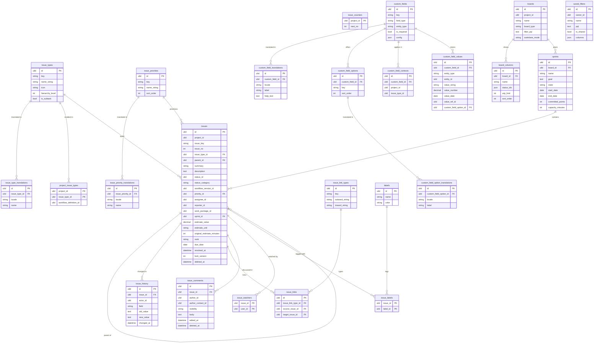

| Table | Key constraints and indexes | First release |
|---|---|---|
| issues | Unique `(tenant_id, issue_key)`, unique `(tenant_id, project_id, issue_no)`; index `(tenant_id, project_id, status_category, rank)`, `(tenant_id, assignee_id, status_category)`, `(tenant_id, sprint_id)`. `rank` is a lexicographic rank string (drag and drop without renumbering). `status_id` references `workflow_statuses` (Workflow module is required). `work_package_id` links time to controlling. | 1.0 |
| issue_counters | Row lock to allocate `issue_no`; issue keys survive project key renames through a key history in `issue_history`. | 1.0 |
| issue_history | Append-only change log; feeds PQL `WAS`/`CHANGED` operators and burndown. | 1.0 |
| custom_fields and values | `entity_type` allows reuse on work packages, service requests, ideas. Typed value columns keep PQL filters index-friendly on all engines; index `(tenant_id, custom_field_id, value_string)`, `(tenant_id, custom_field_id, value_number)`, `(tenant_id, custom_field_id, value_date)`, `(tenant_id, entity_type, entity_id)`. Multi-select = several rows. | 1.0 |
| boards, board_columns, sprints | `board_type` = kanban, scrum. Sprint capacity reduced by absences. | 1.0 |
| saved_filters | PQL text stored with English keywords; field names resolved at runtime. | 1.0 |

---

## 14. Workflow engine

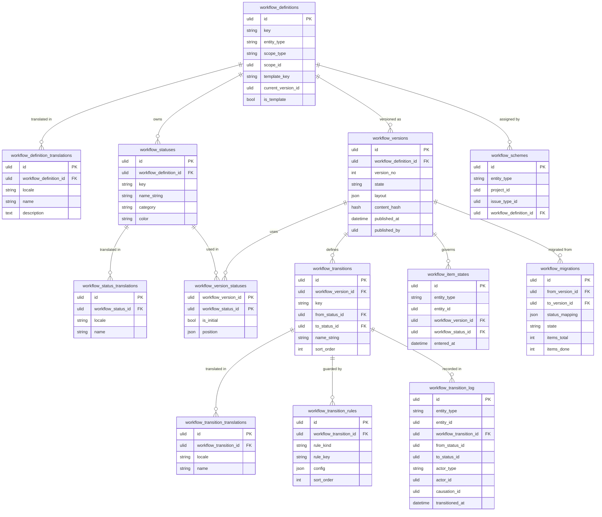

| Table | Key constraints and indexes | First release |
|---|---|---|
| workflow_definitions | Unique `(tenant_id, key)`. `entity_type` = issue, service_request, work_package, quote, invoice, absence_request, timesheet_period, idea. | 1.0 |
| workflow_versions | Unique `(workflow_definition_id, version_no)`; published versions immutable. | 1.0 |
| workflow_statuses | Stable across versions so items keep their status when a new version is published. `category` = todo, in_progress, done. | 1.0 |
| workflow_transitions | `from_status_id` NULL = global transition from any status. | 1.0 |
| workflow_transition_rules | `rule_kind` = condition, validator, post_function; `rule_key` refers to a registered, tested implementation; no user code. | 1.0 |
| workflow_schemes | Unique `(tenant_id, entity_type, project_id, issue_type_id)`; most specific wins. | 1.0 |
| workflow_item_states | Unique `(tenant_id, entity_type, entity_id)`. Issues store their status on `issues` for query speed; other entities use this table. | 1.0 |
| workflow_transition_log | Index `(tenant_id, entity_type, entity_id, transitioned_at)`. | 1.0 |
| workflow_migrations | Safe migration when a version changes; resumable batch job. | 1.0 |

---

## 15. Automation, approvals and SLA

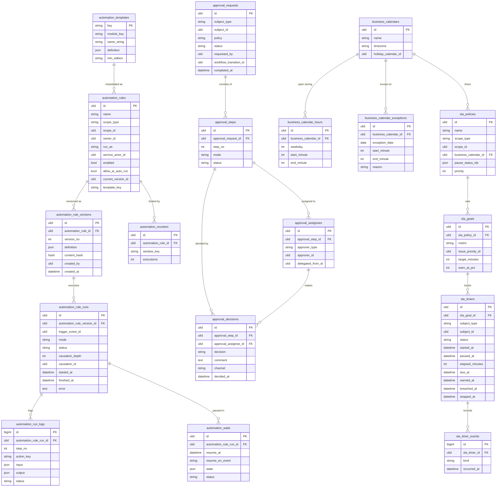

| Table | Key constraints and indexes | First release |
|---|---|---|
| automation_rules | `scope_type` = project, company, global. `run_as` = owner, service_actor. | 1.0 (basic Community, full Business) |
| automation_rule_versions | `definition` = trigger, conditions, branches, actions as a validated JSON tree (ADR-0007). Immutable. | 1.0 |
| automation_rule_runs | Index `(tenant_id, automation_rule_version_id, started_at)`; `mode` = live, dry_run. `causation_depth` enforces loop limits. | 1.0 |
| automation_run_logs | Append-only; inputs/outputs redacted by field permissions of the run actor. Retention configurable (default 90 days). | 1.0 |
| automation_waits | Index `(status, resume_at)`: polled by the scheduler (cron on AMP). | 1.0 |
| automation_counters | Unique `(automation_rule_id, window_key)`; also per-tenant counters (rule id NULL). | 1.0 |
| automation_templates | Instance-scoped library. | 1.0 |
| approval_requests, steps, assignees, decisions | Single, multi-step and parallel; delegation via deputies; decision channel = app, portal, email_link. | 1.0 (engine), 1.1 (service desk) |
| business_calendars | Linked to an absence `holiday_calendar_id` as soft reference. | 1.1 |
| sla_policies, sla_goals, sla_timers | Index `(tenant_id, status, due_at)` for escalation scans; `metric` = first_response, resolution. Pause on "waiting for customer" status. | 1.1 |

---

## 16. Service desk

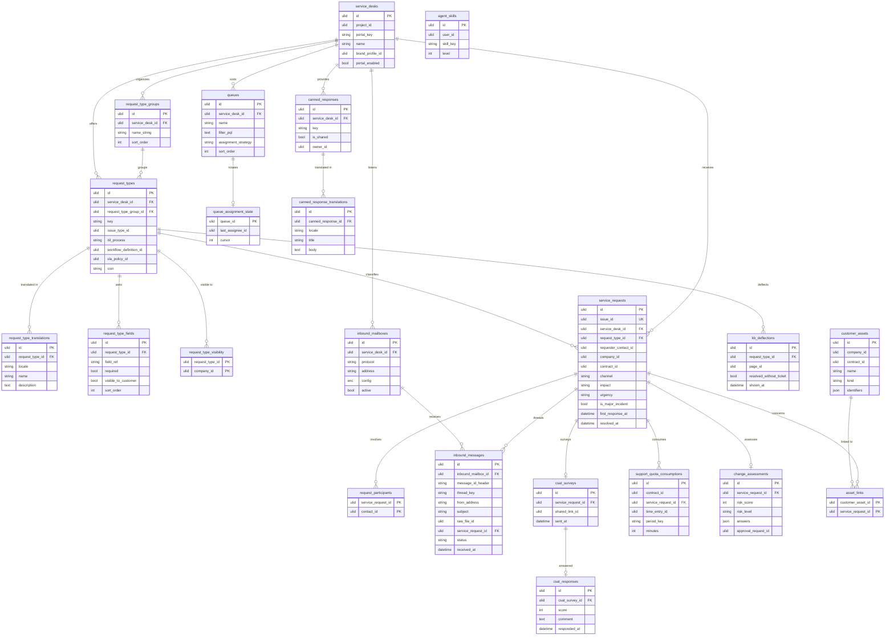

A service request is an issue (Work module) plus a `service_requests` extension row, so boards, PQL, workflows and time booking work unchanged.

| Table | Key constraints and indexes | First release |
|---|---|---|
| service_desks | Unique `(tenant_id, portal_key)`. | 1.1 |
| request_types | `itil_process` = incident, service_request, problem, change, major_incident. | 1.1 |
| request_type_visibility | Service catalog per customer; no rows = visible to all. | 1.1 |
| service_requests | Unique `(issue_id)`; index `(tenant_id, company_id, resolved_at)`. | 1.1 |
| queue_assignment_state | Row lock for round robin. | 1.1 |
| inbound_messages | Unique `(inbound_mailbox_id, message_id_header)`: idempotent email ingestion. | 1.1 |
| csat_surveys, csat_responses | One survey per resolved request. | 1.1 |
| support_quota_consumptions | Index `(tenant_id, contract_id, period_key)`; fires quota-low events. | 1.1 |
| change_assessments | CAB approval through the approval engine. | 1.1 |
| kb_deflections | Requires Knowledge module (soft reference to pages). | 1.3 |
| customer_assets, asset_links | Assets light. | 1.3 |

---

## 17. Absences

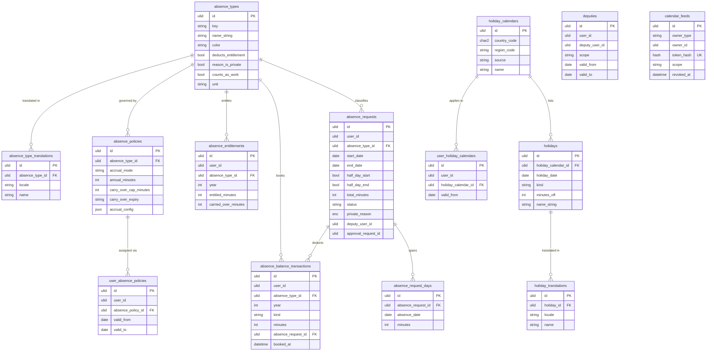

| Table | Key constraints and indexes | First release |
|---|---|---|
| absence_types | Sick leave and similar types set `reason_is_private`; other users see only "absent". | 0.10 |
| absence_policies | `accrual_mode` = yearly, per_pay_period, per_hours_worked (US PTO). | 0.10 (yearly), 1.0 (US accrual) |
| absence_entitlements | Unique `(user_id, absence_type_id, year)`. | 0.10 |
| absence_balance_transactions | Ledger; balance = sum. `kind` = accrual, booking, reversal, adjustment, carry_over, expiry. | 0.10 |
| absence_requests, absence_request_days | Index `(tenant_id, user_id, start_date)`, `(tenant_id, absence_date)` on days for team calendars and capacity. Approval through the engine from 1.0; simple built-in approval in 0.10. | 0.10 |
| holiday_calendars, holidays | Seeded per country pack and region (Baden-Wuerttemberg, Federation of BiH, US federal and states). Shipped calendars layered instance rows; tenant closures as tenant rows. | 0.10 |
| deputies | `scope` = approvals, tickets, queues, all. | 0.10 |
| calendar_feeds | ICS subscription; token hashed. | 0.10 |

---

## 18. Knowledge

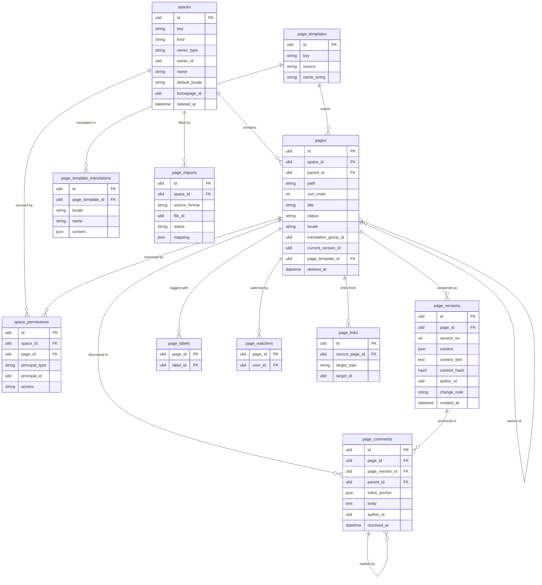

| Table | Key constraints and indexes | First release |
|---|---|---|
| spaces | Unique `(tenant_id, key)`; `kind` = project, customer, team, global. | 1.3 (project templates may reference a space key earlier) |
| pages | Materialized path like work packages; language variants share `translation_group_id`. | 1.3 |
| page_versions | Unique `(page_id, version_no)`; ProseMirror JSON; `content_text` feeds search. Restore creates a new version. | 1.3 |
| page_comments | Inline anchors survive edits via relative positions. | 1.3 |
| page_links | Backlinks and macro targets (issue lists, project status). | 1.3 |
| page_imports | Confluence HTML/XML, Markdown. | 1.3 |
| (real-time co-editing state) | Stored as Y.js update log in a later table `page_collab_updates`; not needed before 2.0. | 2.0 |

---

## 19. Product management

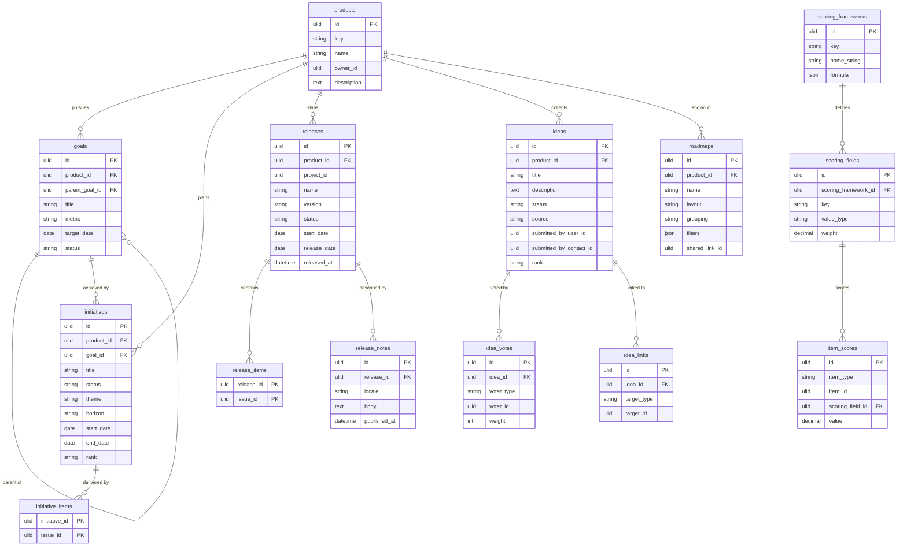

| Table | Key constraints and indexes | First release |
|---|---|---|
| products, goals, initiatives | `horizon` = now, next, later. | 1.2 |
| releases, release_items | Releases also serve Scrum fix versions; `project_id` optional. | 1.0 (versions on issues), 1.2 (roadmap) |
| release_notes | Unique `(release_id, locale)`. | 1.2 |
| ideas, idea_votes | Unique `(idea_id, voter_type, voter_id)`; portal contacts can vote. | 1.2 |
| scoring_frameworks, scoring_fields, item_scores | RICE, WSJF, MoSCoW, value vs effort, custom. Unique `(item_type, item_id, scoring_field_id)`. | 1.2 |
| roadmaps | Shareable read-only link (white-labeled). | 1.2 |

---

## 20. Licensing

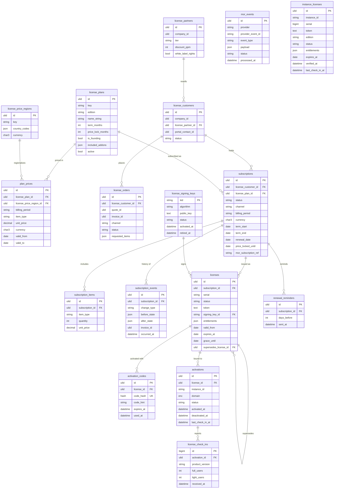

The licensing module runs on the PROJEKTRA instance; its tables are tenant-owned by the PROJEKTRA tenant. `instance_licenses` is instance-scoped and exists on every installation (it stores the license applied to that installation). `license_signing_keys` holds public keys only; private keys stay in a key file or KMS outside the database.

| Table | Key constraints and indexes | First release |
|---|---|---|
| license_plans, plan_prices, license_price_regions | Prices are data. Founding Customer plan: Business edition, 24-month price lock. | 0.9 |
| license_customers | Unique `(tenant_id, company_id)`; linked to CRM company. | 0.9 |
| license_orders | Channel 1 (direct) links quote and invoice. | 0.9 |
| subscriptions, subscription_items, subscription_events | `status` = pending_payment, active, past_due, cancelled, expired. Every change logged. | 0.9 |
| licenses | Unique `(tenant_id, serial)`. Token status (inside the signed `PTKL1` token, ADR-0003) = active, pending_payment (14-day window), trial; row lifecycle adds expired, revoked, superseded. Every reissue (payment received, renewal, seat change) is a new row with a higher serial that supersedes the previous one; tokens are never edited. | 0.9 |
| license_signing_keys | Registry of `kid` and public keys with validity and status (mirrors the public key set shipped in every release). | 0.9 |
| activation_codes | Code shown once (`PTK-XXXX-XXXX-XXXX`), stored as peppered SHA-256; revocable; attempts rate limited. | 0.9 |
| activations | Unique `(license_id, instance_id)` while active; domain encrypted (confidential customer data). | 0.9 |
| license_check_ins | Daily; contains no business data. Retention 13 months. | 0.9 |
| mor_events | Unique `(provider, provider_event_id)`: idempotent webhook processing. | 1.0 |
| renewal_reminders | Unique `(subscription_id, days_before, term_end)` via period column in physical model. | 0.9 |
| instance_licenses | Instance-scoped, one active row. | 0.9 |

---

## 21. AI

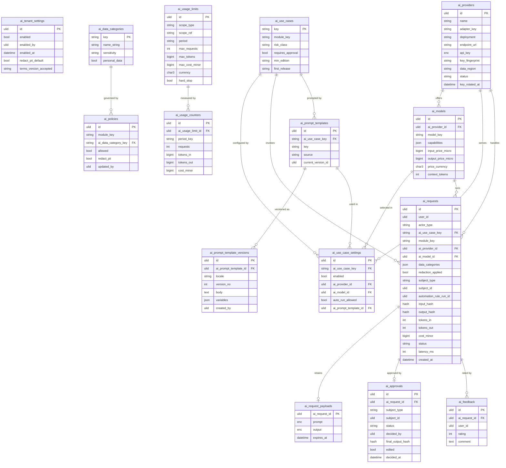

| Table | Key constraints and indexes | First release |
|---|---|---|
| ai_tenant_settings | Unique `(tenant_id)`; absent row or `enabled` false = no AI call possible (ADR-0009). | Tables 0.9 (empty), feature 1.0 |
| ai_providers | API key encrypted with the tenant data key; only the fingerprint is shown. `deployment` = cloud, self_hosted. No vendor names in code paths outside adapters. | 1.0 |
| ai_use_cases, ai_data_categories | Instance-scoped catalogs declared by modules (`module.json` `ai.use_cases`, `ai.data_categories`). | 1.0 |
| ai_use_case_settings | Unique `(tenant_id, ai_use_case_key)`. | 1.0 |
| ai_policies | Unique `(tenant_id, module_key, ai_data_category_key)`; default deny. | 1.0 |
| ai_usage_limits, ai_usage_counters | `scope_type` = tenant, module, user. Unique `(ai_usage_limit_id, period_key)`; counters incremented atomically before the call (reservation) and corrected after. | 1.0 |
| ai_requests | Index `(tenant_id, created_at)`, `(tenant_id, user_id, created_at)`, `(tenant_id, ai_use_case_key)`. Every call, including blocked and failed ones. Also mirrored as an `audit_log` entry. | 1.0 |
| ai_request_payloads | Optional retention (default off, max 30 days), encrypted; purged by job. | 1.0 |
| ai_approvals | Unique `(ai_request_id)`; required for customer-facing and financial use cases. | 1.0 |
| ai_prompt_templates, versions | Layered (system and tenant). Unique `(ai_prompt_template_id, locale, version_no)`. | 1.0 |

---

## 22. Reporting and dashboards

```mermaid
erDiagram
    dashboards {
        ulid id PK
        ulid owner_id
        string scope
        string name
        json layout
    }
    dashboard_widgets {
        ulid id PK
        ulid dashboard_id FK
        string widget_key
        string module_key
        json config
        json position
    }
    saved_reports {
        ulid id PK
        ulid owner_id
        string report_key
        string name
        json definition
        bool is_shared
    }
    report_schedules {
        ulid id PK
        ulid saved_report_id FK
        string cron
        json recipients
        string format
        bool active
        datetime last_run_at
    }
    report_runs {
        ulid id PK
        ulid report_schedule_id FK
        string status
        ulid file_id
        datetime started_at
    }
    project_health_rules {
        ulid id PK
        string scope_type
        ulid scope_id
        string metric
        json thresholds
    }
    project_health_snapshots {
        ulid id PK
        ulid project_id
        date snapshot_date
        string health
        json metrics
    }
    controlling_period_facts {
        ulid id PK
        ulid project_id
        ulid contract_id
        ulid work_package_id
        string period_key
        int planned_minutes
        int actual_minutes
        int billable_minutes
        bigint cost_minor
        bigint revenue_minor
        bigint invoiced_minor
        bigint eac_minor
        datetime computed_at
    }

    dashboards ||--o{ dashboard_widgets : shows
    saved_reports ||--o{ report_schedules : "delivered by"
    report_schedules ||--o{ report_runs : produces
    project_health_rules ||--o{ project_health_snapshots : evaluates
```

| Table | Key constraints and indexes | First release |
|---|---|---|
| dashboards, dashboard_widgets | Widgets declared by modules (extension point). | 0.9 (getting started, personal), 1.2 (shared, advanced) |
| saved_reports, report_schedules, report_runs | Report builder output XLSX/PDF. | 1.2 |
| project_health_rules, project_health_snapshots | Traffic light; unique `(project_id, snapshot_date)`. | 0.9 (default rule), 1.2 (configurable) |
| controlling_period_facts | Read model rebuilt from events (time approved, invoice finalized, incoming invoice assigned); unique `(tenant_id, project_id, contract_id, work_package_id, period_key)`. Keeps p95 under 300 ms with 100,000 entries. | 0.9 (budget consumption), 1.2 (EAC) |

---

## 23. Integration, import and onboarding

```mermaid
erDiagram
    import_jobs {
        ulid id PK
        string source
        ulid file_id
        json mapping
        bool dry_run
        string status
        json stats
        ulid started_by
    }
    import_job_items {
        ulid id PK
        ulid import_job_id FK
        string source_ref
        string target_type
        ulid target_id
        string status
        text error
    }
    onboarding_progress {
        ulid id PK
        ulid user_id
        string flow
        string step_key
        datetime completed_at
        datetime skipped_at
    }
    sample_data_sets {
        ulid id PK
        string locale
        json manifest
        datetime seeded_at
        datetime removed_at
    }
    calendar_connections {
        ulid id PK
        ulid user_id
        string provider
        enc credentials
        string sync_token
        datetime last_synced_at
    }
    payment_provider_accounts {
        ulid id PK
        string provider
        string mode
        enc credentials
        bool active
    }
    data_subject_requests {
        ulid id PK
        string subject_type
        ulid subject_id
        string kind
        string status
        ulid result_file_id
        datetime completed_at
    }

    import_jobs ||--o{ import_job_items : processes
```

| Table | Key constraints and indexes | First release |
|---|---|---|
| import_jobs, import_job_items | Unique `(import_job_id, source_ref)`; mapping from source IDs to Projektrack IDs makes re-runs idempotent. Sources: csv_clients (0.9), spreadsheet_reports (0.10), freedcamp (1.0), jira, confluence, ms_project (1.3). | 0.9 |
| onboarding_progress | Unique `(tenant_id, user_id, flow, step_key)`; tenant-level steps have `user_id` NULL. | 0.9 |
| sample_data_sets | Removal deletes exactly the manifest's rows. | 0.9 |
| calendar_connections | CalDAV, Microsoft 365, Google (described as calendar connectors). | 1.3 |
| payment_provider_accounts | Tenant is the merchant. | 1.1 |
| data_subject_requests | GDPR/CCPA export and erasure respecting retention. | 0.9 |

SaaS control plane data (instances, regions, rollout waves, backups, tenant routing, partner accounts) lives in a separate control plane database operated by PROJEKTRA and is not part of the product schema (ADR-0006).

---

## 24. Entity count summary

| Domain | Entities |
|---|---|
| Core A: tenancy, identity, access | 21 |
| Core B: platform services | 13 |
| Core C: files, documents, sharing, integration | 16 |
| CRM | 13 |
| Projects | 18 |
| Time | 17 |
| Rates | 10 |
| Service reports | 12 |
| Quotes | 9 |
| Invoicing A | 20 |
| Invoicing B | 16 |
| Work | 24 |
| Workflow engine | 13 |
| Automation, approvals, SLA | 18 |
| Service desk | 22 |
| Absences | 14 |
| Knowledge | 11 |
| Product | 14 |
| Licensing | 17 |
| AI | 15 |
| Reporting and dashboards | 8 |
| Integration, import, onboarding | 7 |
| **Total** | **328** |

---

## 25. Cross-module contracts

Modules never read or write another module's tables. They interact through:

1. **Domain events**, written to `outbox_events` in the same transaction as the change and dispatched after commit to in-process listeners, the queue, automation triggers and webhooks. Events are versioned (`schema_version`); a consumer must tolerate unknown fields. Payloads carry IDs and the minimum facts needed; consumers fetch more through contracts and permissions.
2. **Query and command contracts** (PHP interfaces in the core `Contracts` namespace, for example `TimeEntryQuery`, `RateResolver`, `TaxEngine`, `DocumentRenderer`, `WorkflowRuntime`, `AiGateway`). When the providing module is disabled, a null implementation returns empty results or a clear "module disabled" error.

### 25.1 Domain events

| Event | Publisher | Consumers | First release |
|---|---|---|---|
| TenantCreated | core | onboarding, licensing (seat counting), country packs (seed defaults) | 0.9 |
| UserInvited, UserActivated, UserDeactivated | core | licensing (seat count), notifications, absences, service desk (queues) | 0.9 |
| RoleChanged, PermissionsChanged | core | audit, search (permission filters), AI (field access cache) | 0.9 |
| ModuleEnabled, ModuleDisabled | core | navigation, scheduler, automation (suspend rules of disabled module) | 0.9 |
| SettingChanged | core | caches, audit | 0.9 |
| CompanyCreated, CompanyUpdated | crm | licensing (license customer), crm_activities projection, search | 0.9 |
| CompanyTaxStatusChanged | crm | invoices (tax preview for drafts), quotes | 0.9 |
| ProjectCreated, ProjectStatusChanged | projects | time, work (default board), knowledge (space), automation, reporting | 0.9 |
| ContractCreated, ContractChanged | projects | rates, service desk (quotas, SLA), invoices (recurring plans) | 0.9 |
| ContractBudgetThresholdReached | projects | notifications, automation, AI (risk alerts) | 0.9 |
| WorkPackageMoved, WorkPackageClosed | projects | time (booking validation), gantt, reporting | 0.9 |
| TimeEntryBooked, TimeEntryChanged | time | rates (valuation), reporting, service desk (quota), automation | 0.9 |
| TimesheetSubmitted | time | workflow/approvals, notifications, automation | 0.9 |
| TimesheetApproved (TimeEntryApproved per entry) | time | rates (freeze valuation), service reports, invoices (billable pool), reporting | 0.9 |
| TimesheetRejected | time | notifications | 0.9 |
| TimeEntryCorrected | time | rates, reporting, service reports (flag affected versions) | 0.9 |
| PeriodLocked, PeriodUnlocked | time | invoices, audit, reporting | 0.9 |
| RecurringBookingProposed | time | notifications | 0.10 |
| ExpenseSubmitted, ExpenseApproved | time | invoices (rebillable pool), reporting | 0.10 |
| RateRuleChanged | rates | time (revalue unapproved entries), quotes (price hints) | 0.9 |
| ServiceReportGenerated | service_reports | notifications, automation | 0.9 |
| ServiceReportApproved (version frozen) | service_reports | time (billing_status reported), invoices (create invoice from report) | 0.9 |
| ServiceReportSignedOff, ServiceReportCommented | service_reports | notifications, automation, invoices | 1.0 |
| QuoteSent, QuoteDeclined, QuoteExpired | quotes | crm timeline, automation, licensing (orders) | 0.10 |
| QuoteAccepted | quotes | projects (create project, contract, WBS), rates (rules), licensing (order), work and knowledge (optional board and space) | 0.10 |
| InvoiceFinalized | invoices | time and expenses (billing_status invoiced), licensing (pending-payment license), einvoicing, reporting, audit, accounting export | 0.9 |
| InvoiceSent | invoices | crm timeline, automation | 0.9 |
| InvoiceCancelled | invoices | time and expenses (release claims), licensing (revoke or adjust), reporting | 0.9 |
| PaymentRecorded, InvoicePaid | invoices | licensing (activate license), reporting, automation, AI (payment matching feedback) | 0.9 |
| InvoiceOverdue | invoices (scheduler) | dunning, automation, notifications | 0.10 |
| DunningNoticeIssued | invoices | crm timeline, licensing (past due) | 0.10 |
| EInvoiceGenerated, EInvoiceValidationFailed | einvoicing | invoices (block finalize or send), notifications | 0.9 |
| IncomingInvoiceReceived | einvoice_inbound | AI (extraction, coding proposal), notifications | 0.10 |
| IncomingInvoiceAssigned | einvoice_inbound | reporting (project cost), projects (budget consumption) | 0.10 |
| AbsenceRequested | absences | workflow/approvals, notifications | 0.10 |
| AbsenceApproved, AbsenceCancelled | absences | time (target hours), planning, gantt (auto-scheduling), work (sprint capacity), service desk (deputy reassignment), automation | 0.10 |
| HolidayCalendarChanged | absences | workflow (business calendars), SLA (recompute due dates), time | 0.10 |
| IssueCreated, IssueUpdated, IssueFieldChanged | work | automation, notifications, search, service desk, product (rollups) | 1.0 |
| IssueTransitioned (WorkflowTransitioned for other entities) | workflow | automation, SLA timers, service desk (CSAT on resolve), notifications, product | 1.0 |
| CommentAdded | work, knowledge | automation, notifications, service desk (public reply by email), SLA (first response) | 1.0 |
| SprintStarted, SprintCompleted | work | reporting (velocity), product (release burnup) | 1.0 |
| ApprovalRequested, ApprovalGranted, ApprovalRejected | workflow | originating module (time, absences, service desk, quotes, invoices), notifications, automation | 1.0 |
| AutomationRuleFailed, AutomationLimitReached | automation | notifications (rule owner), audit | 1.0 |
| SlaWarningReached, SlaBreached | sla (workflow) | automation (escalation), notifications, reporting | 1.1 |
| ServiceRequestCreated, ServiceRequestResolved | servicedesk | automation, SLA, CSAT, AI (triage), support quota | 1.1 |
| InboundEmailReceived | servicedesk | servicedesk (thread or create), automation | 1.1 |
| SupportQuotaLow | servicedesk | notifications (account manager), automation | 1.1 |
| CsatSubmitted | servicedesk | reporting, automation | 1.1 |
| PagePublished, PageUpdated | knowledge | search, AI (summaries, answers index), service desk (deflection) | 1.3 |
| IdeaSubmitted, IdeaStatusChanged | product | notifications (requester feedback), automation | 1.2 |
| ReleaseShipped | product | knowledge (release notes page), notifications, shared roadmap | 1.2 |
| SubscriptionChanged | licensing | invoices (seat change invoice), licensing (refresh license) | 0.9 |
| LicenseIssued, LicenseActivated, LicenseExpired, LicenseRevoked | licensing | notifications (activation email), crm timeline, audit | 0.9 |
| LicenseCheckInReceived | licensing | licensing (true-up warnings), reporting (MRR/ARR) | 0.9 |
| MorWebhookReceived | licensing | licensing (subscription sync) | 1.0 |
| AiRequestCompleted, AiRequestBlocked | ai | audit, usage counters, originating module | 1.0 |
| AiOutputApproved, AiOutputRejected | ai | originating module (send reply, save quote lines, save booking) | 1.0 |
| AiPolicyChanged, AiProviderChanged | ai | audit, notifications (admins) | 1.0 |
| FileUploaded, FileScanCompleted | core | originating module, incoming invoices, AI (extraction) | 0.9 |
| SharedLinkAccessed | core | audit, notifications (optional) | 0.9 |

### 25.2 Contract rules

- Events are named in past tense, scoped by module, and never removed in a minor release; breaking payload changes increment `schema_version` and both versions are published for one minor release.
- Every consumer is idempotent (keyed by `outbox_events.id`), because the dispatcher guarantees at-least-once delivery.
- Events that cross a permission boundary (webhooks, automation, AI) are filtered by the receiving actor's permissions and field permissions before payload data leaves the module.
- Financial consumers (invoices, licensing) react to events but re-read the authoritative state through the contract inside their own transaction before writing.
