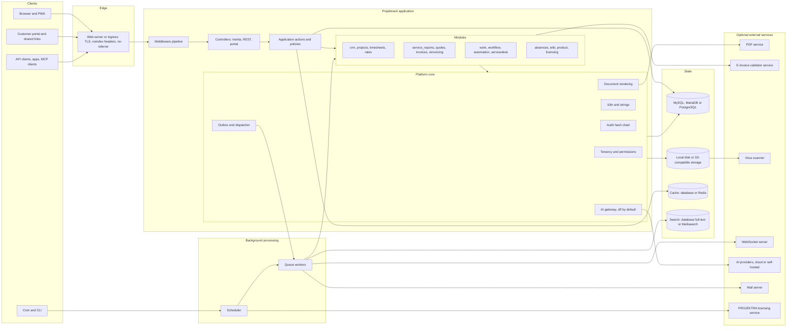

# Projektrack architecture overview

Status: Phase 0 baseline, 16.11.2026. Owner: solution architecture.

Projektrack is a **modular monolith**: one Laravel application, one deployable artifact, one database schema, divided into a small core and independently switchable modules. The same artifact runs on plain AMP shared hosting, Docker Compose, Kubernetes, managed dedicated instances and multi-tenant SaaS. Optional infrastructure is detected and used when present; every optional service has a working fallback.

Related documents: [data-model.md](data-model.md), [modules.md](modules.md), ADR-0002 (module system and plugin SDK), ADR-0006 (multi-tenancy, SaaS, white label), ADR-0007 (workflow and automation engine), ADR-0009 (AI provider layer).

---

## 1. Architectural drivers

| Driver | Consequence |
|---|---|
| Runs on plain AMP without Node, Composer, Redis or Docker on the server | Release ZIP ships `vendor/` and compiled assets; database queue plus one cron entry; every optional service has a fallback. |
| Advanced, secure, easy | Deny-by-default authorization, tenant isolation enforced centrally and at the foreign-key level, audit hash chain, invisible-by-default responses; simple UI on top of a deep domain. |
| Three databases (MySQL 8.4, MariaDB 11.4, PostgreSQL 16) | Portable schema subset, vendor-specific SQL only in tested adapters, full CI matrix. |
| Money, tax and time correctness | Integer minor units and minutes, immutable finalized records, versioned snapshots, tests first. |
| Multilingual with RTL from day one | String identifiers everywhere, one translation layer for backend and frontend, document locale independent of UI locale. |
| Later releases must not break 0.9 data | Complete data model defined in Phase 0; expand/contract migrations only. |
| AI native but off by default | One AI gateway in core, no call possible until a tenant admin enables it. |

---

## 2. Layers

| Layer | Responsibility | Main building blocks |
|---|---|---|
| **Delivery** | Accept requests from people and systems, render responses. | Inertia pages (Vue 3 + TypeScript), REST API (OpenAPI 3.1, versioned under `/api/v1`), customer portal, shared-link pages, MCP server (1.3), inbound webhooks, CLI (`projektrack ...`), scheduler entry (`cron`). |
| **Application** | Orchestrate one use case per action inside a transaction; no business rules of its own. | Form requests (validation), policies (authorization), action classes (`BookTimeEntry`, `FinalizeInvoice`), query objects, resources/transformers, Inertia props builders. |
| **Domain** (per module) | Business rules, invariants, state machines, calculations. Framework-light, unit-tested. | Aggregates and value objects (`Money`, `Minutes`, `TaxCase`, `DateRange`), domain services (`RateResolver`, `TaxEngine`, `NumberSequenceAllocator`), domain events. |
| **Platform core** | Cross-cutting services every module uses through contracts. | Tenancy, identity and permissions (including field permissions), module registry, settings, i18n and string overrides, audit log, outbox and event dispatch, files, document rendering, notifications, search adapter, workflow runtime (1.0), AI gateway (1.0), licensing check. |
| **Infrastructure adapters** | Talk to databases and optional services behind interfaces. | Database adapters (full-text, JSON, locks), queue, cache, search, storage, PDF, e-invoice validator, mail, virus scan, AI providers, payment providers, merchant of record, fiscal adapters. |

Rules:
- Dependencies point inward only: delivery to application to domain; domain never depends on delivery or infrastructure.
- A module may use the core and modules it declares in `requires`. Everything else goes through domain events and contracts (ADR-0002).
- Every UI action is backed by the same application action as the matching API endpoint (API-first).

---

## 3. Modules at a glance

The core is always active. Everything else is a module that can be enabled or disabled per tenant without losing data. Detailed catalog: [modules.md](modules.md).

| Group | Modules |
|---|---|
| Run projects | crm, projects, timesheets, rates, expenses, absences, gantt, planning |
| Prove work | service_reports, signoff |
| Get paid | quotes, invoices, einvoicing, einvoice_inbound, dunning, payment_links, accounting_export, country packs (taxpack_de, taxpack_ba, taxpack_eu, taxpack_us) |
| Work management | workflow, automation, automation_pro, work, product |
| Service | servicedesk |
| Knowledge | wiki |
| Platform and ecosystem | ai, ai_pro, imports, calendar_sync, mcp, sso_enterprise, white_label, multi_company, partner_console, marketplace, licensing |

---

## 4. Component and request flow

---

## 5. Request lifecycle

### 5.1 Interactive request (Inertia or REST)

1. **Edge**: the web server terminates TLS, enforces HSTS and adds `X-Robots-Tag`, `Referrer-Policy: no-referrer` and the remaining security headers (also for static files). No `Server` or `X-Powered-By` disclosure.
2. **Tenant resolution**: the host is looked up in `tenant_domains` (cached). Unknown host returns a generic 404 without branding. On a dedicated-database tenant the connection is switched here (ADR-0006).
3. **Security middleware**: CSP with nonce, CSRF (web), rate limiting per IP, user, token and OAuth app, optional IP allowlist and hidden login path.
4. **Authentication**: session (web) or bearer token (API, scoped) or shared-link token (hashed lookup, expiry, revocation, optional password). Enforced 2FA per role; re-authentication for sensitive actions.
5. **Context**: locale (user, tenant, `bs`, `en`), regional formats, time zone, brand profile, license entitlements are bound to the request context.
6. **Module gate**: the route belongs to a module; if the module is disabled for the tenant or not covered by the license edition, the request ends with a plain-language 404/403. Disabled modules expose no routes, navigation, widgets or jobs.
7. **Validation**: form request validates input; messages are string identifiers resolved in the user's language.
8. **Authorization**: policy check on the action and the subject (deny by default), project role check, then field permissions applied to input (cannot write hidden fields) and output (hidden fields removed, never just masked in the UI).
9. **Action in a transaction**: domain logic executes; the audit entry and the domain events are written in the same transaction (`audit_log`, `outbox_events`). Financial actions lock the rows they depend on (number sequence, period lock, chain head).
10. **Response**: Inertia props or JSON resource, with `noindex` meta in HTML. Errors never echo internal URLs, paths or stack traces.
11. **After commit**: the dispatcher forwards outbox events to synchronous listeners (cheap projections) and to the queue (notifications, webhooks, automation, search indexing, AI jobs, PDF rendering).

### 5.2 Background work

- **Queue**: database queue on AMP (processed by the cron-driven worker with a time budget per run), Redis with Horizon when available. Every job carries the tenant ID and re-enters tenant context before running; jobs are idempotent.
- **Scheduler**: one cron entry per minute runs the scheduler: outbox dispatch, automation waits, SLA scans, recurring bookings and invoices, report schedules, renewal reminders, license check-in, retention purges, audit checkpoints.
- **Long tasks** (batch service reports, imports, workflow migrations) run as resumable chunked jobs with progress stored in the database, so they also complete on shared hosting with execution time limits.

---

## 6. Progressive infrastructure fallbacks

| Capability | Baseline (plain AMP) | Enhanced (when configured) | Detection and notes |
|---|---|---|---|
| Queue | Database queue, worker started by cron each minute with a time budget | Redis queue with Horizon, dedicated workers | `QUEUE_CONNECTION` and connectivity check in `projektrack doctor`. |
| Scheduler | System cron every minute; optional web-cron URL with secret for hosts without cron | Same, or a scheduler container | Last run timestamp shown in admin health. |
| Cache | Database or file cache | Redis | Automatic; cache keys are tenant-prefixed. |
| Sessions | Database sessions | Redis sessions | Same session data model. |
| Atomic locks | Database locks (`SELECT ... FOR UPDATE` on lock rows) | Redis locks | Financial locks always use the database, regardless of Redis. |
| Search | Database full-text (MySQL/MariaDB FULLTEXT, PostgreSQL `tsvector`) through the search adapter, with LIKE fallback | Meilisearch | Index rebuild command; permission filters applied in both. |
| Real-time updates | Smart polling (adaptive interval, ETag) | WebSockets (Reverb) | Client negotiates; same event payloads. |
| File storage | Local disk outside the web root, signed download URLs | S3-compatible storage (for example MinIO) | Per-tenant prefix in both. |
| PDF rendering | mPDF (pure PHP, RTL and Arabic shaping) | Gotenberg for pixel-perfect output from DOCX/HTML | Template declares preferred engine; falls back to mPDF. |
| DOCX and XLSX | PhpWord TemplateProcessor, PhpSpreadsheet | Same | Pure PHP everywhere. |
| E-invoice validation | PHP XSD plus Schematron (EN 16931, XRechnung rules) | Bundled or remote validator service | Validator name and version stored with every result. |
| Virus scanning | Strict type and size validation, no execution from upload paths, scan status `skipped` | ClamAV | Admin sees which mode is active. |
| Mail | SMTP or sendmail | Transactional mail provider via SMTP | Inbound mail: IMAP polling by cron; webhook ingestion when available. |
| AI | None (all features have a non-AI path) | Tenant-configured cloud or self-hosted providers | Off by default (ADR-0009). |
| Real-time co-editing | Page locking with conflict detection | Y.js collaboration server | 2.0. |
| License validation | Offline signature check of the installed license | Daily online check-in | Check-in failure never blocks until expiry plus grace. |

---

## 7. Deployment profiles

| Profile | Target | Topology | Tenancy | Updates | First available |
|---|---|---|---|---|---|
| **AMP / shared hosting** | Small self-hosted teams, hosting resellers | Apache or Nginx, PHP 8.4+, MySQL or MariaDB, cron; release ZIP with web installer | Usually one tenant; multi-tenant possible | One-click update in admin with backup and rollback; no SSH needed | 0.9 |
| **Docker Compose** | Self-hosted with root access | app, worker, scheduler, database, Redis, Meilisearch, Gotenberg, MinIO, reverse proxy with automatic TLS | One or more tenants | `projektrack update` pulls signed image, migrates, health-checks, rolls back on failure | 0.9 |
| **Managed dedicated instance** | First customer license (C-03), customers wanting isolation without operating it | Docker Compose profile on PROJEKTRA servers in an EU data center, customer domain | Single tenant per instance | PROJEKTRA rolls out after the customer-zero period | 0.9 (delivery critical path) |
| **Kubernetes** | Larger self-hosted and Enterprise | Helm chart: horizontally scaled web and workers, external database and S3, cert-manager | One or more tenants | Helm upgrade, rolling, zero downtime | 1.0 |
| **Multi-tenant SaaS** | Cloud Free, Business, Enterprise | Per region (EU default, US from 1.1): shared application cluster, shared database with tenant scope; database-per-tenant for Enterprise; wildcard DNS and certificate; custom domains with automatic TLS | Many tenants | Waves via the control plane | 1.0 (self-signup) |
| **Partner-managed** | Partners and resellers | Any of the above, white-labeled | Many tenants or instances | Partner console | 2.0 |

All profiles run the same artifact and the same migrations. Dev, staging and demo instances require basic auth or IP allowlisting in front of the application, and use synthetic data only.

---

## 8. Quality attributes and how they are met

| Attribute | Mechanism |
|---|---|
| Tenant isolation | Central tenant scope, tenant-safe composite foreign keys, tenant context in jobs, tenant-prefixed cache, storage and search; cross-tenant attack tests in CI (ADR-0006). |
| Tamper evidence | Audit hash chain with signed checkpoints; content hashes on frozen documents. |
| Performance | p95 page transition under 300 ms with 100,000 time entries and 50,000 tickets per tenant (verified from 1.0, A-12); read models (`controlling_period_facts`), tenant-leading composite indexes, cursor pagination. |
| Portability | Portable type subset, adapter layer, CI on three databases and on the AMP profile. |
| Upgradability | Expand/contract migrations, upgrade matrix in CI from 0.9, automatic backup and rollback. |
| Discretion | Invisible-by-default responses and CI crawl test; no third-party requests. |
| Observability | Structured logs with correlation ID, health endpoint returning only `OK`, admin health screen, `projektrack doctor`. |
