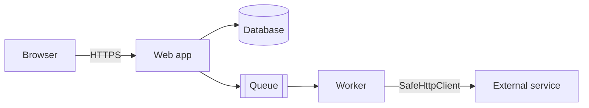

# Threat model: <Module name>

| Field | Value |
|---|---|
| Module key | `<key>` |
| Edition | Community / Business / Enterprise |
| Version of this model | 1 |
| Last updated | DD.MM.YYYY |
| Authors | <role names> |
| Independent reviewer | security-engineer |
| Status | Draft / Reviewed / Accepted |
| Related ADRs and stories | ADR-xxxx, docs/stories/<release>/<story>.md |

Rules: synthetic examples only; every threat has an owner, a mitigation that links to a control in `docs/security/security-baseline.md`, and a test or review gate that verifies it. Open high risks block the milestone.

---

## 1. Scope and assets

- What the module does (3 to 5 sentences):
- In scope:
- Out of scope:

| Asset | Classification (public, internal, confidential, finance, personal, secret) | Why it matters |
|---|---|---|
| | | |

## 2. Actors and entry points

| Actor | Trust level | Entry points (routes, API endpoints, jobs, webhooks, shared links, MCP tools, AI actions, CLI) |
|---|---|---|
| Anonymous visitor | Untrusted | |
| Shared-link visitor | Untrusted, token-bound | |
| Portal user | Low | |
| Employee | Medium | |
| Finance user | High, field permissions | |
| Tenant admin | High, tenant scope | |
| Instance operator | High, no business data by default | |
| External system (webhook, IdP, AI provider) | Untrusted | |

## 3. Data flow diagram

Describe trust boundaries (browser to app, app to database, app to queue, app to external services, tenant to tenant).

Trust boundaries:
1.
2.

## 4. Permissions and tenant scope

| Action | Permission | Field-level restrictions | Tenant scope enforced by | Negative test |
|---|---|---|---|---|
| | | | Global scope / explicit parameter | `tests/Security/...` |

## 5. STRIDE analysis

Rate likelihood (L) and impact (I) as 1 (low) to 3 (high); risk = L x I. Risk 6 or higher is high.

| ID | Category | Threat (attacker, entry point, asset) | L | I | Risk | Mitigation (baseline control) | Verification (test, CI job, review) | Owner | Status |
|---|---|---|---|---|---|---|---|---|---|
| S-01 | Spoofing | | | | | | | | Open |
| T-01 | Tampering | | | | | | | | Open |
| R-01 | Repudiation | | | | | | | | Open |
| I-01 | Information disclosure | | | | | | | | Open |
| D-01 | Denial of service | | | | | | | | Open |
| E-01 | Elevation of privilege | | | | | | | | Open |

Prompts per category:
- **Spoofing**: session or token theft, shared link guessing, webhook forgery, IdP response forgery, impersonation by automation or AI actions.
- **Tampering**: changing amounts, rates, times or statuses after approval; mass assignment; tampering with exports or audit entries; cross-tenant ID substitution.
- **Repudiation**: actions without audit entry; automation or AI actions without actor attribution; missing approval records.
- **Information disclosure**: cross-tenant reads; hidden fields in API, exports, search, notifications or AI context; URLs, tokens or versions leaked (invisibility rules); verbose errors.
- **Denial of service**: expensive queries, large exports, upload bombs, automation loops, queue flooding on the AMP profile, rate limits.
- **Elevation of privilege**: missing policy, role escalation through settings, IDOR, jobs running with elevated rights, plugin capabilities.

## 6. Invisible by default checklist

- [ ] New routes, downloads and shared links carry no-index headers (crawl test covers them).
- [ ] No third-party requests, no external fonts, scripts or embeds.
- [ ] No product name, version or framework exposed before login.
- [ ] Tokens never logged, never in referrer, never in outbound URLs.

## 7. Finance and AI specifics (if applicable)

- Money as integer minor units, immutability after posting, gapless numbering, cancellation instead of deletion:
- AI data categories used (D0 to D4), approval required, audit fields:

## 8. Residual risks and decisions

| Risk | Why accepted | Accepted by | Review date |
|---|---|---|---|
| | | | |

## 9. Change log

| Version | Date | Change | Reviewer |
|---|---|---|---|
| 1 | DD.MM.YYYY | Initial model | |
